

<h1 align="center">طمأنينة | Tamaninah</h1>

<b>كل تجربة ممكن تكون بداية لاكتشاف الإسلام.</b>

  <a href="https://tamaninah.netlify.app"><b>🌿 جرّب طمأنينة الآن ← tamaninah.netlify.app</b></a>

  <a href="media/tamaninah-film.mp4">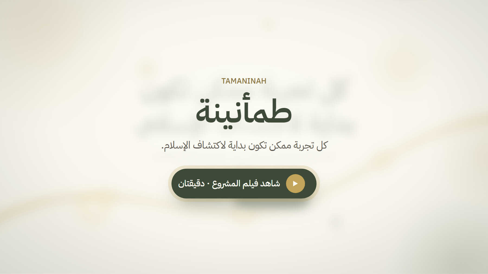</a>

## الفكرة

كل يوم نمرّ بمواقف ومشاعر وأسئلة: فرحة بوظيفة جديدة، خوف من بكرة، امتنان على نعمة، أو سؤال عن الإسلام نفسه.
وكل وحدة منها ممكن تكون بداية تكتشف فيها ماذا قال الله ورسوله ﷺ عمّا تعيشه.

في «طمأنينة» تكتب بكلامك العادي، ولا تحتاج أن تعرف اسم الموضوع. تختار الموضوع الأقرب لك، ثم تمشي معك رحلة قصيرة:

**آية ← تفسيرها ← حديث صحيح ← موقف من سيرة النبي ﷺ يشبه ما تمر به ← خطوة عملية ← مساحة خاصة لدعائك**

وهي للمسلم الذي يريد فهمًا أعمق، ولغير المسلم الذي يريد التعرف على الإسلام من مصادره الصحيحة، بالعربية والإنجليزية.

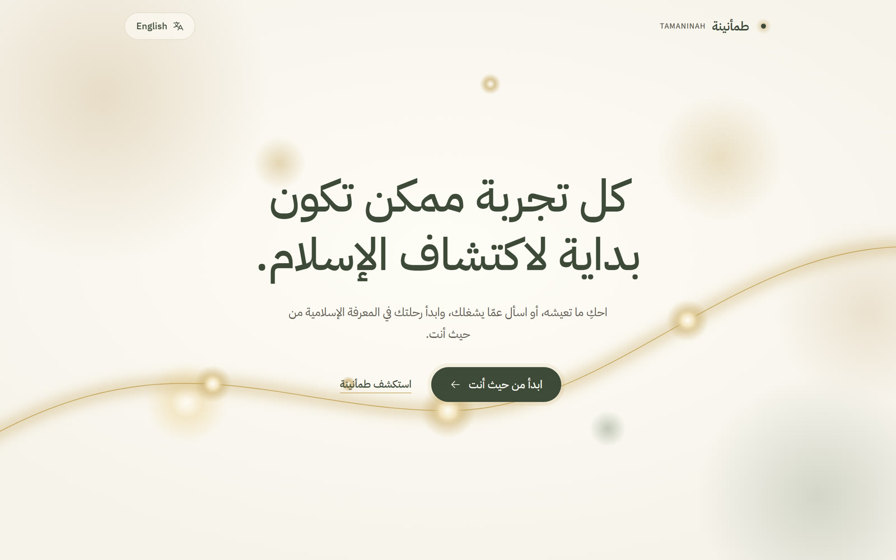

## ما الذي يميّزها؟

- **الذكاء الاصطناعي يفهم ويرتّب فقط، ولا يكتب أي نص شرعي من عنده.** كل آية وتفسير وحديث يُعرض بنصّه الحرفي من مصدره المعتمد، مع رقمه وصفحته ورابطه.
- **لا فتاوى.** الأسئلة التي تحتاج حكمًا شخصيًا تُحال بأمانة إلى أهل العلم.
- **الصدق قبل كل شيء.** إذا لم تجد في مصادرها ما يغطي سؤالك، تقول ذلك بوضوح بدل أن تخترع جوابًا.
- **الدعاء لك وحدك.** مساحة الدعاء في نهاية الرحلة لا تُرسل ولا تُحفظ.
- **لا تحفظ ما تكتبه.** لا توجد قاعدة بيانات لرسائل الناس.
- **مصممة للجوال**، ومتاحة بالعربية والإنجليزية.

## من الداخل

<table>
<tr>
<td width="50%">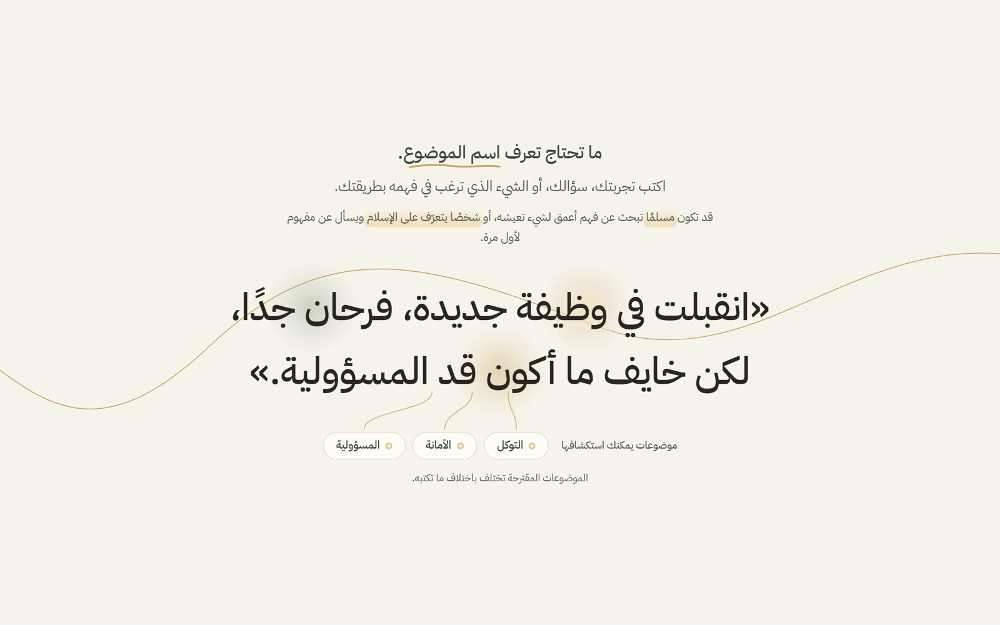 تكتب تجربتك بكلامك، والموضوعات تُقترح من كلامك</td>
<td width="50%">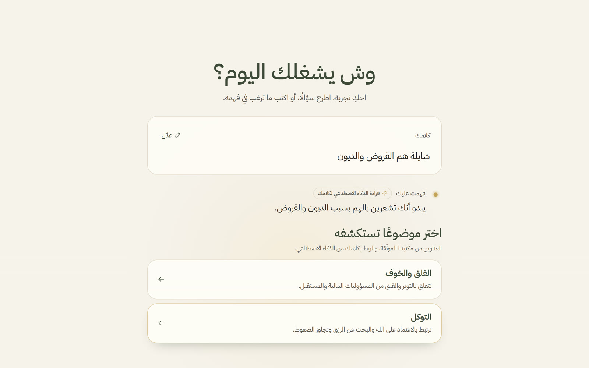 يفهم الذكاء الاصطناعي ما كتبته، وأنت تختار الموضوع</td>
</tr>
<tr>
<td>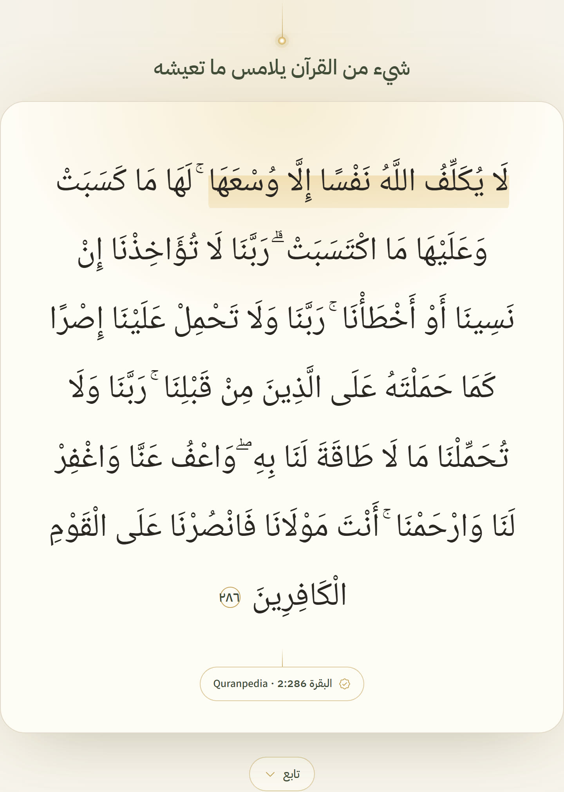 الآية بنصّها، مع مصدرها</td>
<td>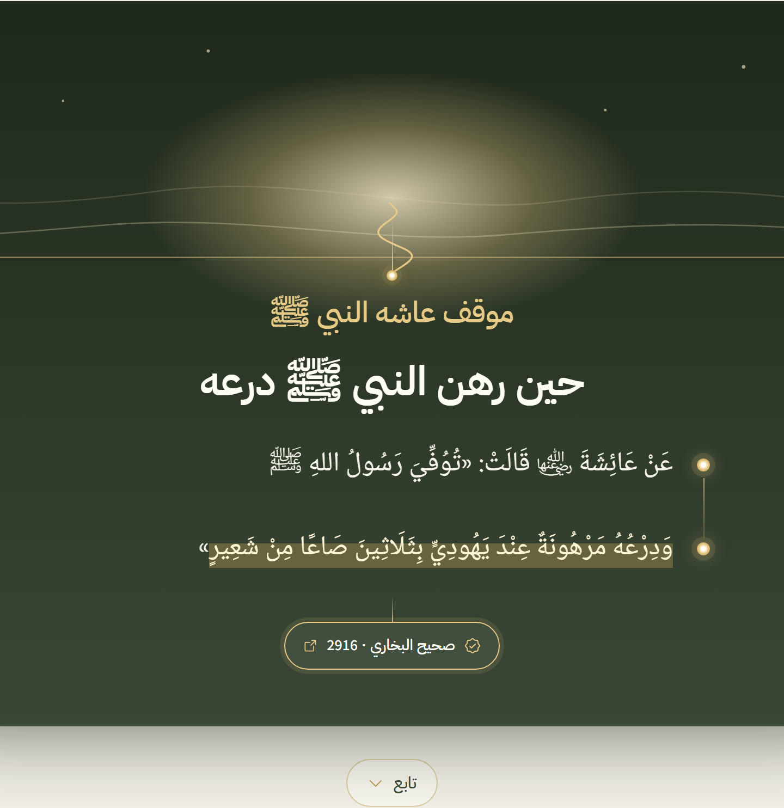 موقف عاشه النبي ﷺ يشبه ما تمر به، من صحيح البخاري</td>
</tr>
<tr>
<td>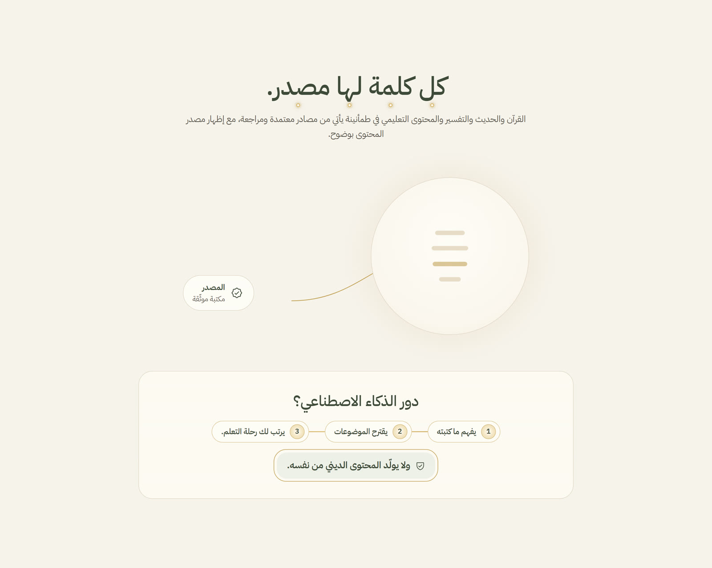 كل كلمة لها مصدر</td>
<td>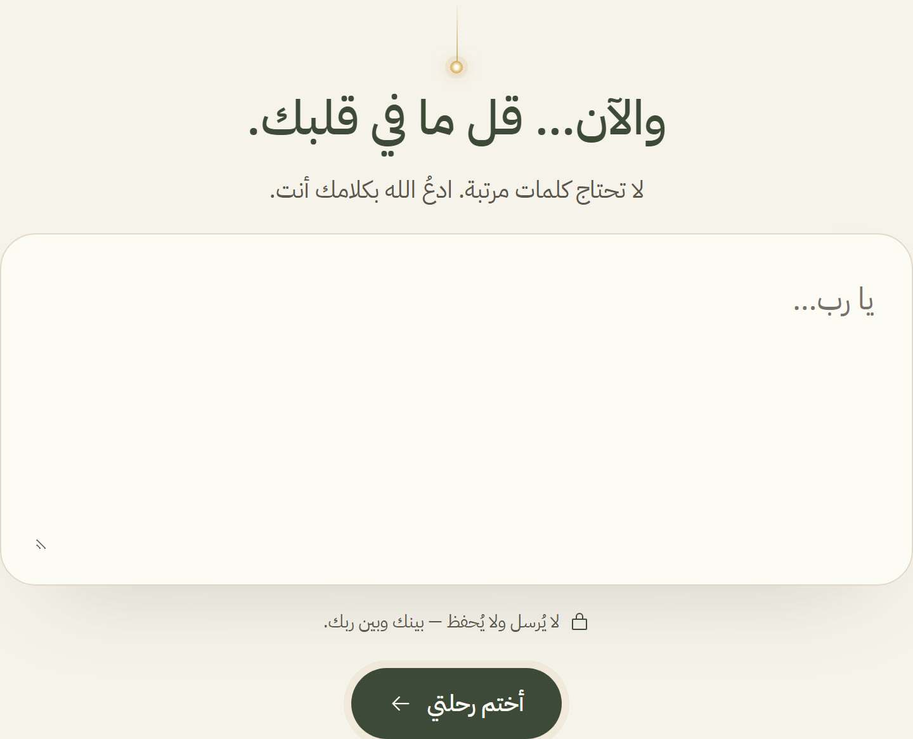 والآن… قل ما في قلبك: لا يُرسل ولا يُحفظ</td>
</tr>
</table>

### على الجوال

  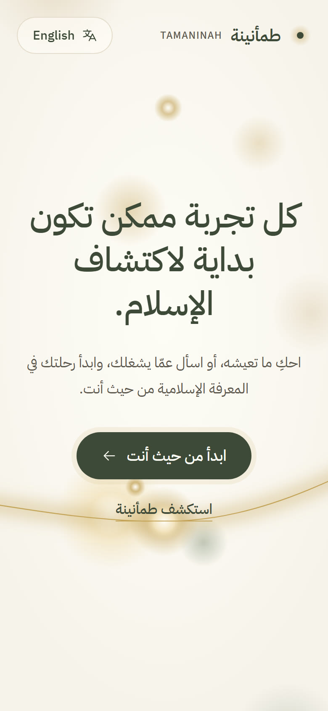
  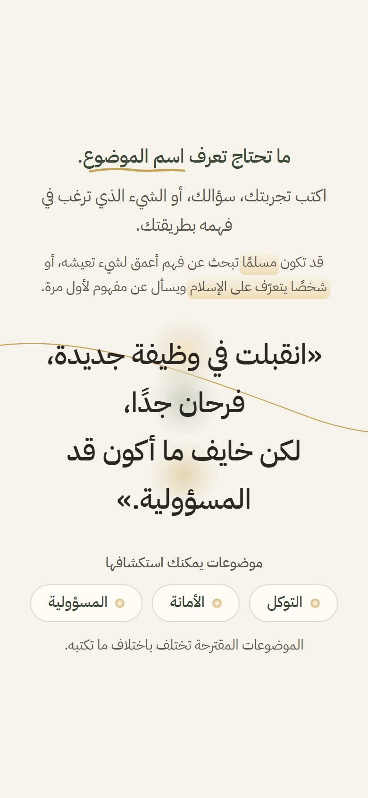
  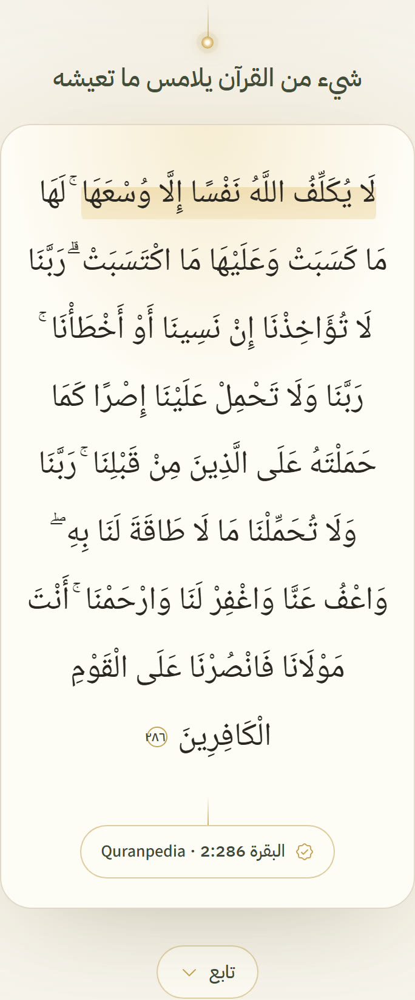
  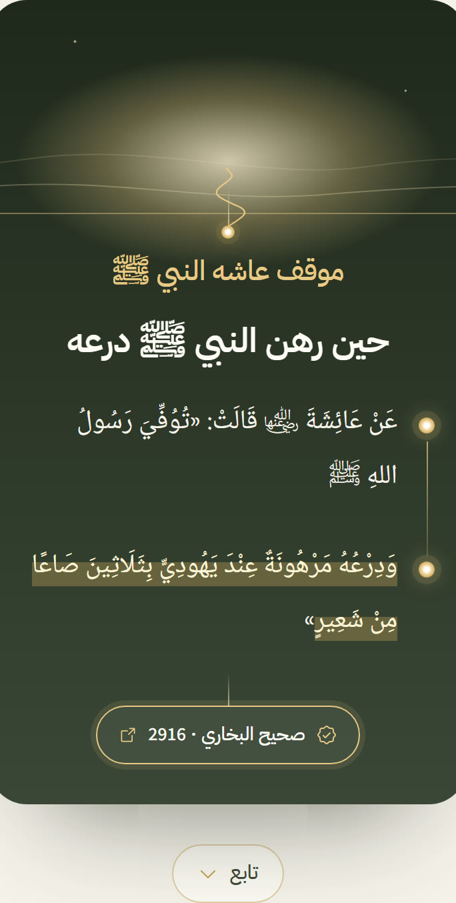

## المصادر

نص القرآن الكريم وتفسير الطبري عبر Quranpedia، وصحيحا البخاري ومسلم وسيرة ابن هشام عبر المكتبة الشاملة،
وكتاب «بينات: أسئلة وأجوبة عن الإسلام» (مركز أصول)، ومقاطع حرفية من موسوعة الجمهرة.

## التقنية

React 19 · TypeScript · Vite · GSAP · Netlify Functions · Gemini

في التقييم الآلي: 34 حالة اختبار، كل واحدة ثلاث مرات على النموذج الحقيقي، وفُحص 380 حقلًا شرعيًا معروضًا،
فكانت كلها مطابقة حرفيًا لمصادرها. **صفر نص شرعي كتبه النموذج.**

---

صاحبة الفكرة: المهندسة يارا عبدالرحيم الطويرقي

---

## English

**Tamaninah** is an Arabic-first (and English) web experience for anyone who wants to learn about Islam, starting from
something they are living through, feeling, or wondering about, without needing to know the name of the topic.

Write in your own words, choose a topic, and walk a short journey: **a verse → its tafsir → a Sahih hadith → a moment
from the Prophet's ﷺ life that mirrors yours → one practical step → a private space for your own du'a** (never sent,
never stored).

**The AI only understands and routes. Every religious text is shown verbatim from its approved source**, with its
reference and link. No fatwas, and an honest "not covered" instead of an invented answer.

▶ **Try it:** https://tamaninah.netlify.app · 🎬 **Film:** [media/tamaninah-film.mp4](media/tamaninah-film.mp4)

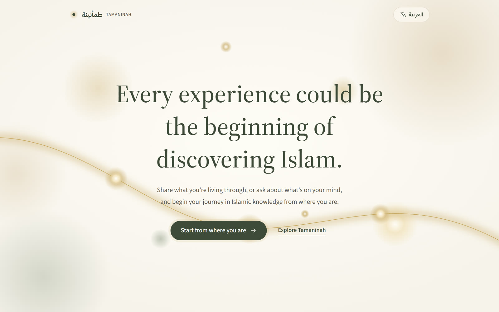

